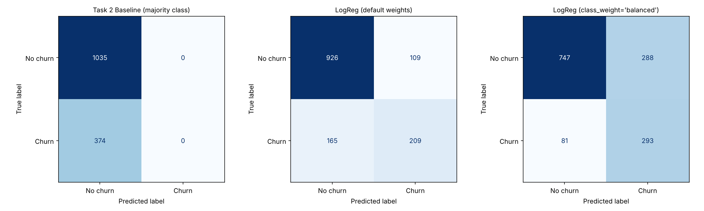

# CHURN-PREDICTION-BASELINE-PIPELINE# TELCO-CHURN-CLASSIFICATION-PIPELINE

A correctly validated **Logistic Regression** pipeline that predicts customer churn on the Telco Customer Churn dataset. The project handles class imbalance explicitly, compares two class-weighting strategies against a majority-class baseline, and ends with a business recommendation on which model to deploy.

Built as Week 4 (Machine Learning) task for the NeuroFive internship program.

## Highlights

- Stratified 80/20 train/test split (`stratify=y`), so train and test both keep the 26.5% churn rate
- Full scikit-learn `Pipeline`: imputation, scaling and one-hot encoding are fit on training data only, so there is no data leakage
- `TotalCharges` type issue fixed (11 blank strings converted to numeric)
- `customerID` excluded from features
- Metrics beyond accuracy: precision, recall, F1, ROC-AUC and confusion matrices
- Threshold sweep to show the precision/recall trade-off
- Business-framed recommendation

## Results

Test set (1,409 customers), Churn = positive class:

| Model | Accuracy | Precision | Recall | F1 | ROC-AUC |
|---|---|---|---|---|---|
| Majority-class baseline | 0.7346 | 0.0000 | 0.0000 | 0.0000 | 0.5000 |
| Logistic Regression (default weights) | 0.8055 | 0.6572 | 0.5588 | 0.6040 | 0.8419 |
| Logistic Regression (`class_weight='balanced'`) | 0.7381 | 0.5043 | 0.7834 | 0.6136 | 0.8414 |



| Model | Missed churners (FN) | False alarms (FP) | Churners caught (TP) |
|---|---|---|---|
| Default weights | 165 | 109 | 209 |
| Balanced | 81 | 288 | 293 |

## Key findings

- The baseline reaches 73.5% accuracy by predicting "No churn" for everyone, yet it finds zero churners. Accuracy alone is misleading on imbalanced data.
- Default weights give the best accuracy and precision but miss 165 of 374 churners.
- `class_weight='balanced'` lifts recall from 55.9% to 78.3% and halves the missed churners, at the cost of more false alarms.
- ROC-AUC is nearly identical for both models (about 0.84). Class weighting shifts the decision boundary; it does not improve how well customers are ranked.
- **Recommendation:** deploy the balanced model. It catches 84 more churners and adds 179 false alarms, so it pays off whenever a missed churner costs more than roughly 2.1 retention offers.
- Churn risk rises with short tenure, month-to-month contracts and fiber-optic internet, and falls with long tenure and two-year contracts.

The full write-up is in [MODEL_COMPARISON.md](MODEL_COMPARISON.md).

## Project structure

```
.
├── Telco_Churn_Colab.ipynb                 Notebook version (runs in Google Colab)
├── classification_baseline.py              Script version
├── MODEL_COMPARISON.md                     Metrics table, confusion matrices, business interpretation
├── WA_Fn-UseC_-Telco-Customer-Churn.csv    Dataset
├── confusion_matrices.png                  Confusion matrix plots
├── metrics_table.csv                       Metrics for all three models
├── threshold_sweep.csv                     Precision/recall at thresholds 0.30, 0.40, 0.50
├── results.json                            Metrics and confusion matrices as JSON
└── README.md
```

## How to run

**Google Colab**

1. Open [Google Colab](https://colab.research.google.com) and choose File, then Upload notebook.
2. Select `Telco_Churn_Colab.ipynb` and click Runtime, then Run all.
3. Upload `WA_Fn-UseC_-Telco-Customer-Churn.csv` when prompted.

**Locally**

```bash
pip install pandas numpy scikit-learn matplotlib
python classification_baseline.py
```

The script reads the CSV from the same folder, prints the classification reports, and writes the metrics files and the confusion matrix image.

## Method

| Step | Detail |
|---|---|
| Target | `Churn` (Yes = 1, No = 0) |
| Cleaning | `TotalCharges` converted with `pd.to_numeric(errors="coerce")`; `customerID` dropped |
| Split | `train_test_split(test_size=0.20, stratify=y, random_state=42)` |
| Numeric features | Median imputation, then `StandardScaler` (`tenure`, `MonthlyCharges`, `TotalCharges`) |
| Categorical features | `OneHotEncoder(handle_unknown="ignore", drop="if_binary")` |
| Models | `DummyClassifier(most_frequent)`, `LogisticRegression`, `LogisticRegression(class_weight='balanced')` |
| Evaluation | Accuracy, precision, recall, F1, ROC-AUC, confusion matrix, threshold sweep |

## Dataset

[Telco Customer Churn](https://www.kaggle.com/datasets/blastchar/telco-customer-churn) from Kaggle: 7,043 customers, 21 columns, about 27% churn.

## Tech stack

Python, pandas, NumPy, scikit-learn, Matplotlib
